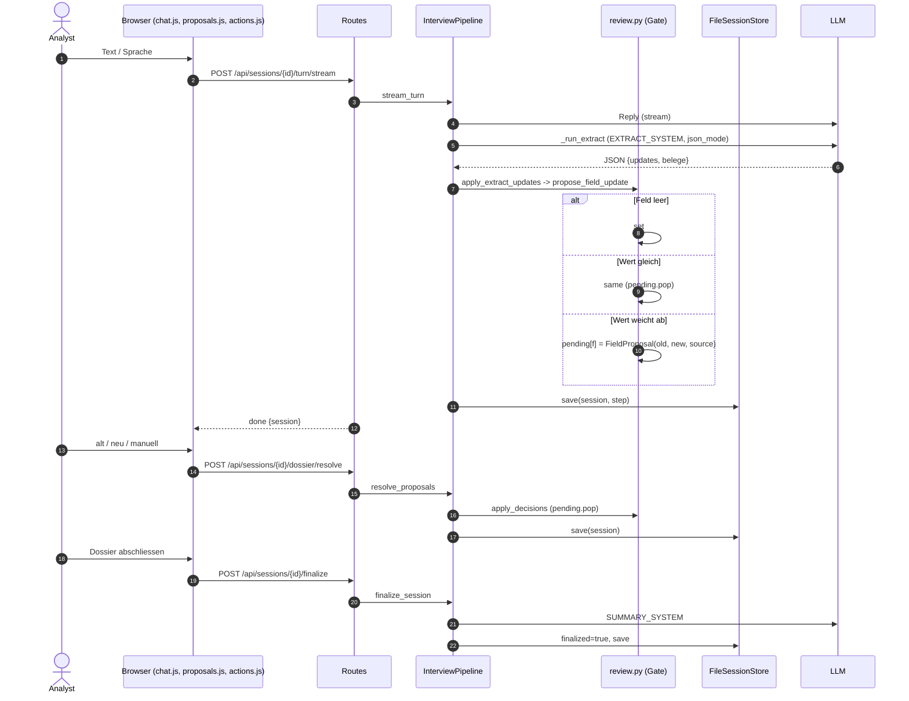

# Plan: pluggbares Trainings-Modul (`features/training/`)

Status: **Plan, nichts implementiert.** Stand der Code-Analyse: Pipeline, Review-Gate, Routen und UI wie im Repo.

## 1. Ziel

Aus normalem Betrieb Trainingsdaten gewinnen, ohne die Kernlogik zu verändern:

| Datensatz | Quelle | Signal |
|---|---|---|
| **Extraktions-DPO / Tool-Call-Training** | Merge-Konflikt-Auswahl (alt / neu / manuell) | echtes menschliches Label |
| **Tool-Call-SFT** | akzeptierte Extraktionen (`new`) und unstrittige Felder | schwaches bis mittleres Label |
| **Antwort-DPO** (optional, Phase 3) | Konversation | **kein** Label, nur synthetisch mit Judge |

Das Modul muss **abschaltbar** sein (Default aus) und darf bei Fehlern den Turn nie abbrechen.

## 2. Ist-Zustand: wo was passiert



| Schritt | Code | LLM |
|---|---|---|
| Extrahieren | `InterviewPipeline._run_extract` (`pipeline.py:197`) | ja |
| Konflikt entsteht | `propose_field_update` (`review.py:57`) | nein |
| Konflikt lösen | `proposals.js save()` -> `resolve_dossier` (`dossier/routes.py:87`) -> `apply_decisions` (`review.py:151`) | nein |
| Abschliessen | `actions.js finalize()` -> `finalize_session` (`pipeline.py:144`) | 1 Call |
| Speichern | `FileSessionStore.save` (`sessions/store.py:50`), bei **jedem** Turn | nein |

`dossier/resolve` wird ausschliesslich vom UI aufgerufen. Der Server löst nie selbst auf.

## 3. Lücken im Bestand (warum Capture nötig ist)

1. `apply_decisions` macht `pending.pop` und speichert die Entscheidung nirgends.
2. Der Roh-Output des Extract-LLM wird nicht gespeichert. Der Prompt hängt an `recent_history` (letzte 8 Messages) und ist später nicht sicher rekonstruierbar.
3. Nicht jedes Verschwinden von `pending` ist eine menschliche Entscheidung:
   - **still gelöst:** Die Maschine liefert später wieder den alten Wert (`same`).
   - **überschrieben:** Ein zweiter Vorschlag ersetzt den ersten. Nur das erste `old` bleibt, das erste `new` geht verloren.
   - **ungelöst beim Abschliessen:** Nur das UI warnt per `confirm`. `pending` bleibt in der gespeicherten Session.
4. Bulk-Buttons ("Alles neu", Zeile, alle) erzeugen viele Entscheidungen mit einem Klick. Das ist ein schwächeres Signal als eine einzeln gewählte Karte.
5. Der `tool-webhook`-Pfad (`source="tool"`) hat **keinen** Prompt und keinen Modell-Output aus dieser App. Er kann kein Extraktions-DPO liefern.

## 4. Architektur

```
src/startup_voice/features/training/
  __init__.py
  events.py            # Event-Typen, Recorder-Protocol, NullRecorder
  recorder.py          # JsonlRecorder -> data/sessions/<id>/events.jsonl
  builders/
    __init__.py        # Registry
    base.py            # ExampleBuilder-Protocol, Example
    extract_conflict.py  # DPO: manual/old vs. LLM-Vorschlag
    toolcall_sft.py      # SFT: akzeptierte Tool-Call-Ausgaben
    reply_judge.py       # Phase 3, optional
  export.py            # Builder laufen lassen, filtern, splitten, JSONL schreiben
  cli.py               # `uv run startup-voice-export ...`
tests/test_training_*.py
```

Prinzipien:

- **Eine Richtung der Abhängigkeit:** `training` importiert `domain`, aber `domain`, `review.py` und `scoring.py` importieren `training` nie.
- **`review.py` bleibt rein** (kein I/O, kein Recorder). Die Pipeline vergleicht `pending` vor und nach dem Gate und leitet die Events daraus ab.
- **Capture und Export sind getrennt.** Capture schreibt Rohereignisse. Beispiele (Paare) entstehen erst beim Export, damit sich Builder und Filter später ändern lassen, ohne Daten zu verlieren.
- **Fail-safe:** `emit()` fängt alle Exceptions und loggt nur. Ein Fehler im Recorder bricht nie einen Turn ab.

## 5. Events

Alle Events: `{ "v": 1, "type": ..., "session": id, "ts": ISO, "turn": int, "language": "de|en", ... }`, eine JSON-Zeile in `events.jsonl`.

| Event | Wann | Inhalt |
|---|---|---|
| `extract` | nach `_run_extract` | `system`, `user` (exakt die gesendeten Strings), `raw` (Roh-Output), `parsed_updates`, `focus`, `model` |
| `proposal_open` | Gate hat `pending[f]` neu angelegt | `slot`, `field`, `old`, `new`, `source`, `quote`, `extract_ref` (Turn) |
| `proposal_superseded` | zweiter Vorschlag ersetzt den ersten | `slot`, `field`, `previous_new`, `new` |
| `proposal_implicit_same` | `pending` verschwindet, weil Maschine den alten Wert liefert | `slot`, `field`, `old`, `new` |
| `decision` | direkt vor `pending.pop` in `resolve_proposals` | `slot`, `field`, `old`, `new`, `choice`, `manual_text`, `via` |
| `finalize` | nach `finalize_session` | `open_conflicts` (Liste), `coverage`, `ready_for_closing` |
| `reply` (Phase 3) | nach Reply | `system`, `user`, `reply` |

`via` kommt vom UI. Ohne UI-Änderung ist es aus dem Request ableitbar: `forcedChoice` gesetzt = Bulk, sonst Karte. Dafür bekommt `DecisionBody` in `dossier/routes.py` ein **optionales** Feld `via: "card" | "row" | "all"` (Default `"card"`). `proposals.js` setzt es in `save()`. Alte Clients bleiben kompatibel.

### Wie die Pipeline die Events ableitet (ohne `review.py` anzufassen)

In `_run_extract`:

1. `before = {(slot, field): FieldProposal copy}` aus allen `session.objects[*].pending`.
2. `apply_extract_updates(...)` wie bisher.
3. `after` bilden und vergleichen:
   - in `after`, nicht in `before` -> `proposal_open`
   - in beiden, `new` geändert -> `proposal_superseded`
   - in `before`, nicht in `after`, und `fields[f]` gleich dem Maschinenwert -> `proposal_implicit_same`

In `resolve_proposals`: vor `apply_decisions` die passenden `pending`-Einträge kopieren und pro Decision ein `decision`-Event schreiben. Erst nach erfolgreichem `apply_decisions` (alles oder nichts) senden, damit bei einem `ValueError` keine falschen Labels entstehen.

## 6. Eingriffe im Bestand

| Datei | Änderung | Risiko |
|---|---|---|
| `features/interview/pipeline.py` | `__init__(..., recorder=None)`; `NullRecorder` als Default; Emit in `_run_extract`, `resolve_proposals`, `finalize_session` | niedrig, Default ändert nichts |
| `features/dossier/routes.py` | `DecisionBody.via` optional | niedrig |
| `features/dossier/ui/proposals.js` | `via` in `save()` mitschicken | niedrig |
| `web.py` | Recorder aus `TRAINING_CAPTURE=on` bauen und in die Pipeline geben | niedrig |
| `.env.example`, `README.md` | `TRAINING_CAPTURE`, Export-CLI dokumentieren | keins |
| `pyproject.toml` | optionaler Script-Eintrag für den Export | niedrig |

Nicht geändert: `review.py`, `scoring.py`, `domain.py`, `store.py`.

## 7. Builder

### 7.1 `extract_conflict` (DPO)

Nur Events mit `decision` **und** zugehörigem `extract`-Event (Prompt + Roh-Output vorhanden).

| `choice` | chosen | rejected | Stärke |
|---|---|---|---|
| `manual` | Mensch-Text | LLM-Vorschlag | stark |
| `old` | alter Wert | LLM-Vorschlag | mittel |
| `new` | -- (Positivbeispiel für SFT) | -- | kein Paar |

Das `chosen`/`rejected` ist die **ganze Extract-JSON-Antwort**, bei der nur das betroffene Feld ersetzt wurde. Alles andere bleibt identisch, damit das Paar genau den Unterschied isoliert.

Hinweis zu `old`: Der alte Wert stammt aus einem früheren Turn und nicht aus demselben Prompt. Das Paar ist also "Dossier-Wert schlägt Modellvorschlag", kein reines Antwort-Ranking. Es bekommt daher `weight: 0.5` in `meta`.

Nicht erzeugt wird ein Paar bei: `proposal_implicit_same`, `proposal_superseded`, ungelöst bei `finalize`, `source != "chat"`.

### 7.2 `toolcall_sft`

Format wie `tool-webhook` (`slot`, `fields`, `summary`, `evidence`):

- `decision.choice == "new"` -> Vorschlag war richtig.
- `decision.choice == "manual"` -> korrigierte Version als Zielwert.
- Felder, die per `set` (leer -> gefüllt) ohne Konflikt entstanden sind, sind **unstrittig, aber nicht geprüft**. Sie kommen nur mit `--include-unreviewed` in den Export und sind in `meta.reviewed=false` markiert.

### 7.3 `reply_judge` (Phase 3, optional)

Pro Turn N Kandidaten mit anderer Temperatur oder anderem Modell, Bewertung per LLM-Judge mit der Rubrik aus `DEFAULT_REPLY_SYSTEM`. Ergebnis ist **synthetisch** und trägt `meta.synthetic=true`. Es bleibt vom menschlichen Datensatz getrennt.

## 8. Ausgabeformat (TRL-kompatibel)

DPO, eine Zeile pro Beispiel:

```json
{
  "prompt":   [{"role":"system","content":"<EXTRACT_SYSTEM>"},
               {"role":"user","content":"<Transcript ...>"}],
  "chosen":   [{"role":"assistant","content":"{\"updates\":{...Mensch-Wert...}}"}],
  "rejected": [{"role":"assistant","content":"{\"updates\":{...LLM-Wert...}}"}],
  "meta": {"session":"...","turn":3,"slot":"traction","field":"...",
           "source":"chat","choice":"manual","via":"card",
           "language":"de","weight":1.0,"origin":"captured"}
}
```

SFT: `{"messages":[system,user,assistant], "meta":{...}}`.

Ausgabe unter `data/exports/<datum>/{dpo_extract.train.jsonl, dpo_extract.val.jsonl, sft_toolcall.*.jsonl, manifest.json}`. `data/` ist bereits in `.gitignore`.

## 9. Export-Filter und Qualität

- nur **finalisierte** Sessions (konfigurierbar)
- `is_prompt_leak(...)` auf `chosen` und `rejected` (aus `review.py`)
- `manual_text` nicht leer, `chosen != rejected` (normalisiert wie `_norm`)
- Bulk-Entscheidungen (`via in {row, all}`) standardmässig ausgeschlossen, per Flag zulassbar
- Dedupe über Hash aus `(prompt, chosen, rejected)`
- **Split nach Session-ID**, nicht nach Zeile, sonst Leakage zwischen Train und Val
- DE und EN getrennte Dateien (Feld `language`)
- `manifest.json`: Zählung pro Builder, Filtergründe, Code-Version, Zeitpunkt

## 10. Backfill aus Altdaten

Bestand: 11 Sessions (5 finalisiert), 27 Steps, 9 Steps mit offenen Vorschlägen. Die Entscheidung lässt sich nur über den Endwert in `session.json` raten, und spätere Turns können das Feld überschrieben haben.

- Optionales Skript `backfill.py` erzeugt `decision`-Events mit `origin="inferred"`, `confidence="low"`.
- Standardmässig **nicht** im Export. Nur mit `--include-inferred`.
- Kein Prompt-Roh-Output vorhanden -> kein DPO-Paar möglich. Backfill taugt höchstens für Statistik (wie oft wurde was gewählt), nicht fürs Training.

Ehrliche Einschätzung: Der Backfill ist nur für Statistik nützlich. Trainingsdaten entstehen ab dem Einschalten von Capture.

## 11. Datenschutz und Löschen

- Es sind Founder-Daten. `TRAINING_CAPTURE` ist **Default aus** (Opt-in) und das UI zeigt, wenn es an ist (Badge).
- `events.jsonl` liegt **pro Session**. `DELETE /api/sessions/{id}` entfernt den Ordner per `shutil.rmtree` und damit auch die Events.
- **Lücke:** Exporte unter `data/exports/` sind Kopien. Das Löschen einer Session entfernt sie dort nicht. Lösung: `manifest.json` enthält die Session-IDs, und der Export-CLI bekommt `--purge-session <id>`. Das muss im README stehen.
- Optionales Anonymisieren (Namen, E-Mails, Telefonnummern) als Export-Filter, Default an für Dateien ausserhalb von `data/`.

## 12. Risiken

| Risiko | Gegenmassnahme |
|---|---|
| Ein einzelner Analyst trainiert seinen Geschmack ins Modell | `reviewer`-Feld in `decision` (Default `"local"`), Auswertung pro Reviewer |
| Wenige Daten (Dutzende statt Hunderte) | Manifest zeigt Zählung, Export warnt unter einer Mindestmenge |
| Bulk-Klicks verfälschen Labels | `via`-Feld und Standardfilter |
| Recorder verlangsamt Turns | append-only JSONL, kein Lock, keine Netzwerkaufrufe |
| Format-Drift | `v` in jedem Event, Builder prüfen die Version |

## 13. Phasen

**Phase 1: Capture (Aufwand klein)**
- `events.py`, `recorder.py`, Verdrahtung in `pipeline.py` und `web.py`
- `DecisionBody.via` + `proposals.js`
- Tests: Events entstehen korrekt für `open`, `superseded`, `implicit_same`, `decision`, `finalize`; `NullRecorder` ändert nichts; Recorder-Fehler brechen keinen Turn; bei fehlgeschlagenem `apply_decisions` kein `decision`-Event; Löschen der Session entfernt `events.jsonl`

**Phase 2: Builder und Export**
- `extract_conflict`, `toolcall_sft`, `export.py`, CLI, Manifest
- Tests: Paar-Konstruktion pro `choice`; Filter; Split nach Session; Dedupe; Format

**Phase 3: Optional**
- `reply_judge`, `backfill.py`, Anonymisierung

## 14. Akzeptanzkriterien Phase 1

- Mit `TRAINING_CAPTURE` unset verhält sich die App wie vorher; alle bestehenden Tests laufen unverändert.
- Mit `TRAINING_CAPTURE=on` entsteht pro Session eine `events.jsonl`, in der jede UI-Entscheidung genau ein `decision`-Event hat.
- Ein erzwungener Fehler im Recorder erzeugt einen Log-Eintrag und keinen HTTP-Fehler.
- `review.py` hat keinen neuen Import.

## 15. Offene Fragen

1. Soll `reviewer` aus einem Login kommen oder reicht ein fester Wert aus `.env`?
2. Sollen Bulk-Entscheidungen ("Alles neu") überhaupt Trainingsdaten werden, oder nur Einzelkarten?
3. Ziel-Framework für das Training (TRL/Unsloth/watsonx)? Davon hängt ab, ob das `messages`-Format reicht oder ein Template nötig ist.
4. Soll `old` als eigenes schwaches Paar zählen oder nur `manual`?
